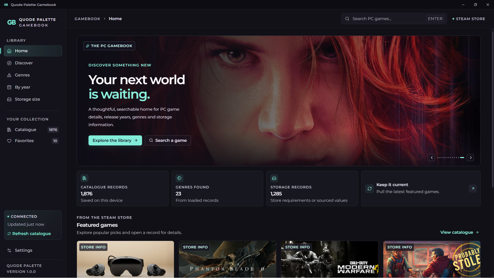
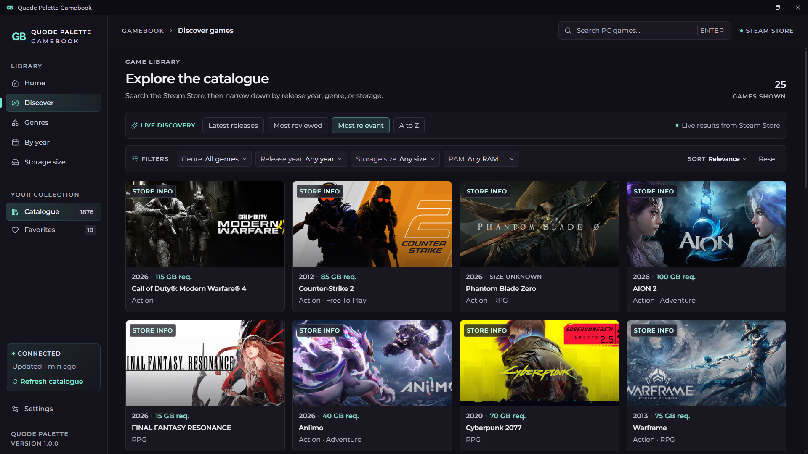
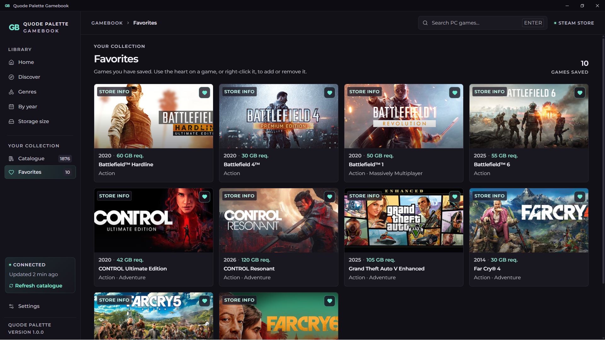
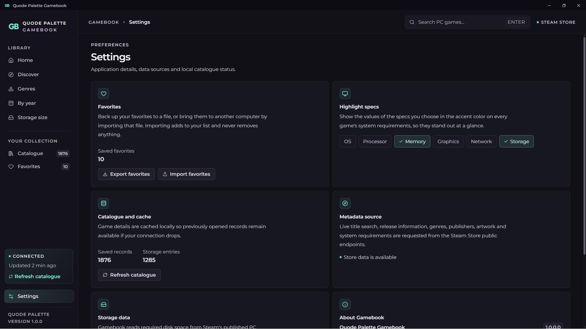
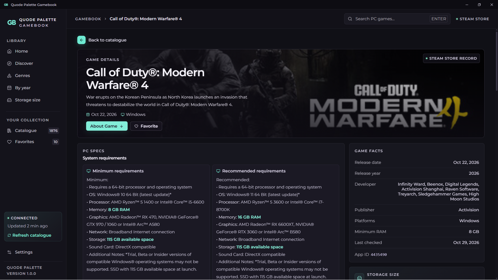
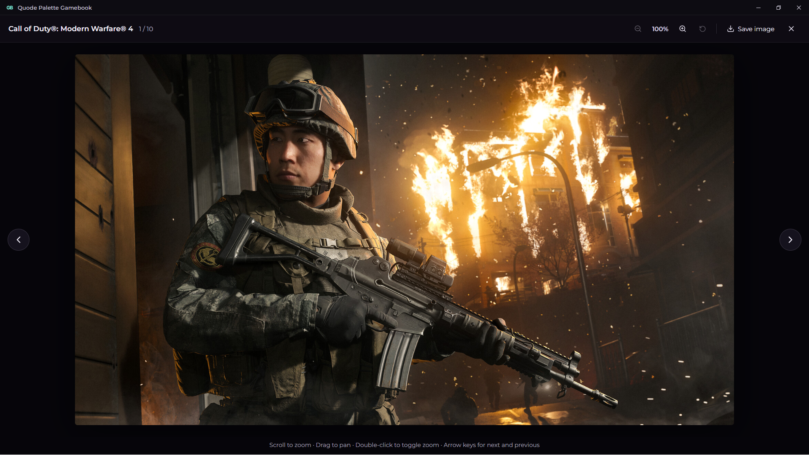
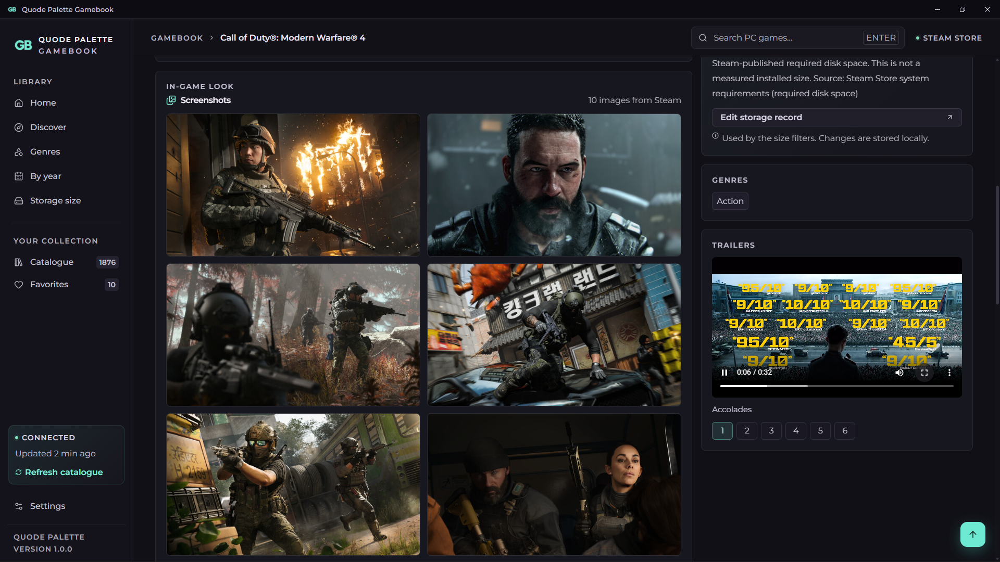

# Quode Palette Gamebook

Gamebook is a Windows app for looking up PC games. Search by title, browse by genre or release year, and check how much disk space and RAM a game asks for before you buy it. Game details come from the Steam Store, and everything you open is saved on your PC so it still works offline.

  
  <b>Screenshot I</b>

<table>
    <td width="50%" align="center">
      
       
      <b>Screenshot II</b>
       
      <!-- Convert common audio formats with FFmpeg -->
    </td>
    <td width="50%" align="center">
      
       
      <b>Screenshot III</b>
       
      <!-- Convert common video formats with FFmpeg -->
    </td>
</table>
<table>
    <td width="50%" align="center">
      
       
      <b>Screenshot IV</b>
       
      <!-- Convert common audio formats with FFmpeg -->
    </td>
    <td width="50%" align="center">
      
       
      <b>Screenshot V</b>
       
      <!-- Convert common video formats with FFmpeg -->
    </td>
</table>
<table>
    <td width="50%" align="center">
      
       
      <b>Screenshot VI</b>
       
      <!-- Convert common audio formats with FFmpeg -->
    </td>
    <td width="50%" align="center">
      
       
      <b>Screenshot VII</b>
       
      <!-- Convert common video formats with FFmpeg -->
    </td>
</table>

## Download

Grab the latest build from the [Releases](../../releases/latest) page. There are two options:

| File | What it is |
| --- | --- |
| `Quode-Palette-Gamebook-v1.0.0-Setup.exe` | Installer. Adds a Start menu entry and can be removed from Windows Settings like any other app. |
| `Quode-Palette-Gamebook-v1.0.0-Portable.zip` | No install needed. Unzip it anywhere and run `Quode Palette Gamebook.exe`. |

## What you can do

- Search Steam by game title
- Browse the catalogue and filter by genre, release year, storage size and RAM
- Read system requirements, with the specs you care about highlighted
- Look through screenshots and watch trailers
- Save games to your favorites, and export or import them as a file
- Add a storage size yourself, with a source, when a game does not list one

## Requirements

- Windows 10 or Windows 11
- Microsoft Edge WebView2 Runtime. Most up to date Windows installations already have it. The installer will download it for you if it is missing, but the portable version will not.
- An internet connection for live searches. Games you have already opened stay available offline.

## About the storage numbers

Gamebook reads the disk space listed in a game's published system requirements. That is not always the same as the download size or the final installed size, so treat it as a guide. If a game does not list one, the app shows it as unknown instead of guessing.

## Your data

Game records and favorites are stored on your own computer. Nothing is sent anywhere except the requests to the Steam Store that load game information and images.

## Not affiliated with Valve

Gamebook is an independent project. It is not made by, endorsed by, or connected to Valve or Steam. Steam and the Steam logo are trademarks of Valve Corporation. Game names, artwork and descriptions belong to their respective owners.

## Font
The Montserrat fonts in `assets/` are under the SIL Open Font License (see `OFL.txt`).

## License

Released under the [PolyForm Noncommercial License 1.0.0](LICENSE). You are free to use, modify and share it for personal, educational and other noncommercial purposes. For commercial use, please get in touch.
[Email Us](mailto:hello@quodepalette.com)

Copyright © Quode Palette
